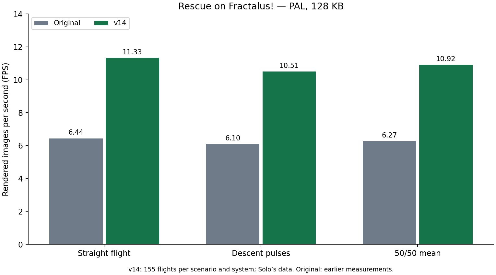
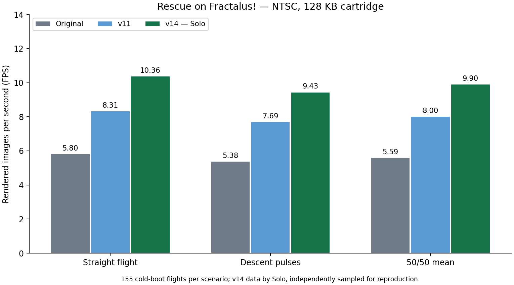

# Rescue on Fractalus! — Atari XL/XE optimization

The first optimization stage was prepared by **nosty** with **ChatGPT-6 Astra** (+18%). Then **Solo**, working with **Opus** agents, achieved about 39%, and **Astra** developed this into v11. **The new v14 optimizations are by Solo and his Opus/Fable team**: this is the up74 release, still fitting a 128 KB cartridge.

[English](README.md) · [Polski](README_PL.md)

[CAR](optimized%20version/Rescue%20on%20Fractalus%21%20-%20optimized%20128KB.car) · [ROM](optimized%20version/Rescue%20on%20Fractalus%21%20-%20optimized%20128KB.rom)

CAR and ROM require the standard 64 KB RAM. Cold-boot the game. **v14 has no updated XEX yet**; the older XEX does not contain these changes.

| System | Original FPS | v11 FPS | v14 FPS | Gain / original | Gain / v11 |
|---|---:|---:|---:|---:|---:|
| PAL | 6.2717 | 8.7829 | **10.9172** | **+74.07%** | **+24.30%** |
| NTSC | 5.5915 | 8.0031 | **9.8961** | **+76.98%** | **+23.65%** |

50/50 result: half the straight-flight mean plus half the descent-flight mean. Solo supplied 620 flights (155 per scenario and system), up to 60 s, cold boot, 170 warmup frames. An independent audit exactly reproduced 50 selected flights. Original and v11 references are historical. No cross-version state transfers; faster VBI can change the randomized planet. Natural early ends remain in the data.

## New optimizations by Solo

- Tighter hidden-subtree rejection and rewritten mountain rasterization.
- Faster column fill with identical image output.
- Table-based multiplication, interpolation and sound queue in VBI.
- Faster grid geometry, preparation and postpass.
- Faster projection and edge loop.
- Safe projection work performed while waiting for the previous image.

[Details / Szczegóły](docs/OPTIMIZATIONS.md) · [Method / Metodyka](docs/benchmarks/METHOD.md) · [Audit / Audyt](docs/benchmarks/UP74_INTEGRATION_AUDIT.md) · [Build](docs/REBUILD.md)

## Directories

- optimized version/ — current CAR, ROM and release information.
- original/ — original ROM.
- dist/ — original-to-current IPS patch and checksums.
- src/ — sources; new Solo work in src/up74.
- scripts/ — rebuilding, measurements and charts.
- results/ — results; current data in results/v14.
- docs/ — changes, methodology and research.
- analysis/ — reverse engineering of the original.
- arc/ — historical up38 material.
