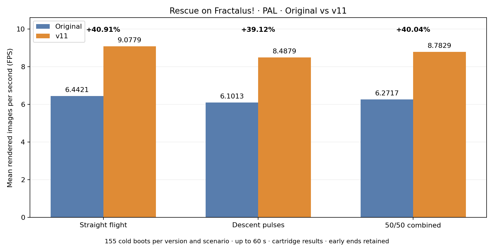
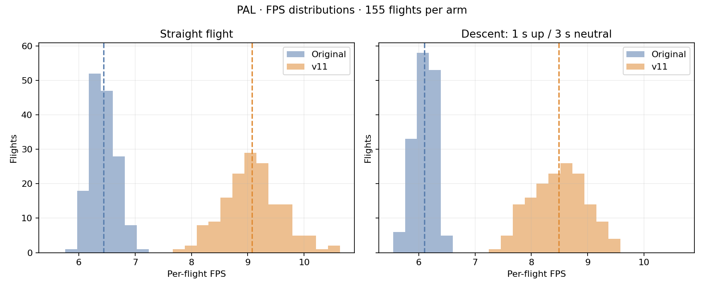
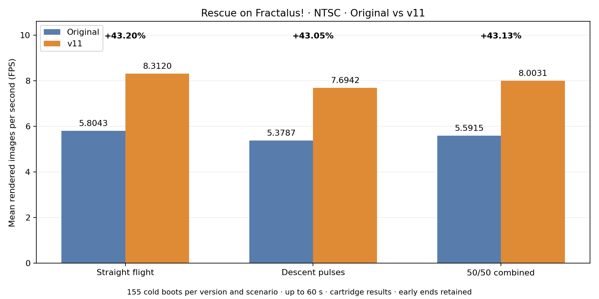
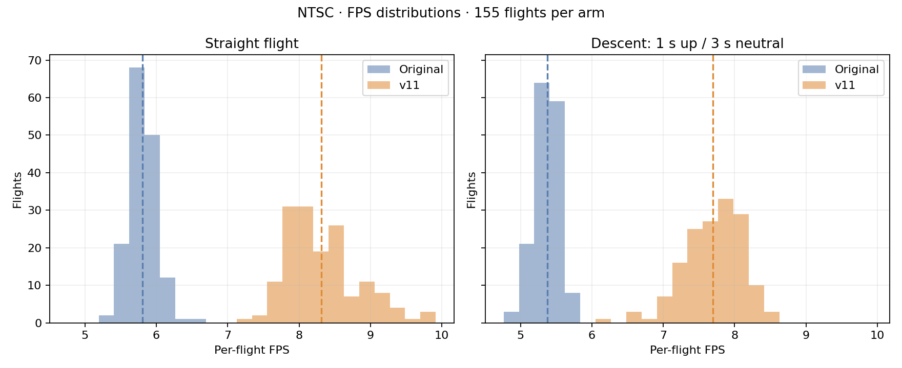

# Rescue on Fractalus! — Atari XL/XE optimization

The first optimization stage was prepared by **nosty** with **ChatGPT-6 Astra** (+18%). Then **Solo**, working with a team of **Opus** agents, found further optimizations, achieving about 39%. **Astra** subsequently improved their work to reach the current result. Release **v11** optimizes Rescue on Fractalus! for Atari XL/XE while preserving terrain detail and screen resolution. The current combined result is **+40.04% PAL and +43.13% NTSC**.

[English](README.md) · [Polski](README_PL.md)

## Download

**[optimized version](optimized%20version/)** contains only the current playable files and version information:

- **[CAR](optimized%20version/Rescue%20on%20Fractalus%21%20-%20optimized%20128KB.car)** / **[ROM](optimized%20version/Rescue%20on%20Fractalus%21%20-%20optimized%20128KB.rom)** — XEGS 128 KB (type 14), Atari XL/XE 64 KB RAM, PAL/NTSC.
- **[XEX](optimized%20version/Rescue%20on%20Fractalus%21%20-%20optimized%20320KB-1MB.xex)** — 320 KB Rambo, 576 KB or 1088 KB RAM; disable BASIC. Includes the level-completion fix.

Cold-boot the new file; an old emulator save state may contain previous code.

## Measured FPS

The results below measure the **cartridge**. XEX passed functional tests, but has not had a separate full FPS series. The introductory percentages summarize historical stages approximately; exact gains depend on video standard and scenario.

### PAL

| Scenario | Original FPS | v11 FPS | Delta FPS | Gain |
|---|---:|---:|---:|---:|
| Straight flight | 6.4421 | 9.0779 | +2.6358 | +40.91% |
| Descent pulses | 6.1013 | 8.4879 | +2.3866 | +39.12% |
| **50/50 combined** | **6.2717** | **8.7829** | **+2.5112** | **+40.04%** |

### NTSC

| Scenario | Original FPS | v11 FPS | Delta FPS | Gain |
|---|---:|---:|---:|---:|
| Straight flight | 5.8043 | 8.3120 | +2.5077 | +43.20% |
| Descent pulses | 5.3787 | 7.6942 | +2.3155 | +43.05% |
| **50/50 combined** | **5.5915** | **8.0031** | **+2.4116** | **+43.13%** |

Each scenario: **155 trials of up to 60 seconds**, a fresh emulator process and cold boot. Descent repeats 1 s joystick up / 3 s neutral. Natural early ends and all observations are retained. FPS counts completed terrain images, not display refresh. The combined result is the 50/50 mean of the two scenarios; gain is a ratio of mean FPS, not a mean of percentages. Original straight-flight results come from the historical independently sampled start schedule; descent shares the v11 schedule.

[Method and data](docs/benchmarks/METHOD.md) · [v11 report](docs/benchmarks/V11_REPORT.md)

## What was optimized

- Reordered terrain rasterization and specialized common mountain-profile depths and widths.
- Accelerated exact division, interpolation and geometry command processing, retaining fallback paths.
- Reduced plotter memory accesses and page-crossing penalties.
- Shortened PMG drawing/erasing and updated only changed cockpit-bar segments.
- Unrolled sound-mixing loops and protected bank switching and Esc resume.
- Solo/Opus: started clearing after the display beam passed the terrain, with buffer safeguards.
- Solo/Opus: skipped provably hidden terrain subdivisions and cleared only necessary column regions.
- Solo/Opus: shortened interrupt work for silent sound channels and the cockpit gauge.
- Solo’s team, including Fable: inlined projection division and streamlined edge iteration.
- Astra: used HD=152 for fully cleared columns and restored Y once at shared rasterizer exits.
- Astra: removed height-to-row conversions from lazy clearing and filling.
- Astra: kept the occlusion threshold in A to reduce repeated loads.
- Adapted Solo’s extended-RAM XEX loader to v11 and fixed music pointers that blocked level completion.

[Full technical description](docs/OPTIMIZATIONS.md) · [Rebuild from source](docs/REBUILD.md)

## Repository layout

- **[optimized version/](optimized%20version/)** — Current v11 CAR, ROM, XEX and version information.
- **[original/](original/)** — Original ROM for rebuilding and comparisons.
- **[dist/](dist/)** — Current IPS patch and checksum manifest.
- **[src/](src/)** — MADS sources; latest banks are in src/v11.
- **[scripts/](scripts/)** — Build, benchmark, analysis and plotting tools.
- **[analysis/](analysis/)** — Reverse-engineering analysis.
- **[results/](results/)** — Selected measurements and validation; latest in results/v11.
- **[docs/](docs/)** — Detailed changes, methodology and research.
- **[arc/up38/](arc/up38/)** — Solo/Opus archive, sources and historical up38 binaries.

Earlier releases remain in Git history. The archived up38 XEX has a known level-completion bug — use v11. Documentation is available in Polish (_PL) and English (no suffix). Memory dumps, save states and test screenshots are excluded. Emulator checks do not cover every game situation or every physical RAM expansion.
