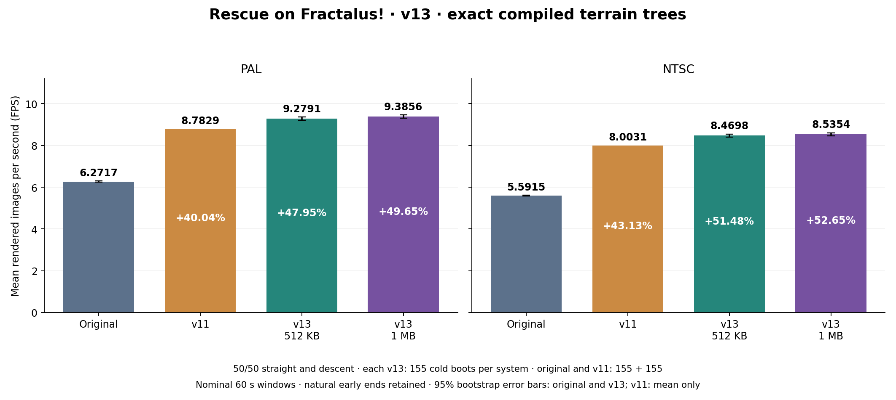

# Rescue on Fractalus! — optymalizacja Atari XL/XE

Pierwszy etap optymalizacji przygotował **nosty** z **ChatGPT-6 Astra** (+18%). Następnie **Solo** z zespołem agentów **Opus** znalazł dalsze optymalizacje uzyskując wynik około 39%. Jego prace znów poprawiła **Astra** uzyskując obecny wynik. **v13** dodaje gotowe drzewa podziału według pomysłu **ilmenita**, na bazie v12.

[English](README.md) · [Polski](README_PL.md)

Oba cartridge’e działają na Atari XL/XE z podstawowymi 64 KB RAM. XEX 512 KB wymaga rozszerzenia 1 MB (1088 KB łącznie), zgodnego bankowania PORTB i wyłączonego BASIC-a. Wariant cartridge’a 1 MB nie ma XEX w tym układzie loadera. Dla XEX na 320/576 KB pozostaje [gałąź v12](https://github.com/nosty3/Rescue-on-Fractalus-Optimization/tree/v12). Uruchamiaj nowe pliki od zimnego startu.

- [CAR 512 KB](optimized%20version/Rescue%20on%20Fractalus%21%20-%20optimized%20512KB.car) / [ROM 512 KB](optimized%20version/Rescue%20on%20Fractalus%21%20-%20optimized%20512KB.rom)
- [CAR 1 MB](optimized%20version/Rescue%20on%20Fractalus%21%20-%20optimized%201024KB.car) / [ROM 1 MB](optimized%20version/Rescue%20on%20Fractalus%21%20-%20optimized%201024KB.rom)
- [XEX 512 KB — 1 MB RAM](optimized%20version/Rescue%20on%20Fractalus%21%20-%20optimized%20512KB%20-%201MB%20RAM.xex)

| System | Wariant | FPS | Zysk względem oryginału | Zysk względem v11 |
|---|---|---:|---:|---:|
| PAL | 512 KB | **9.2791** | **+47.95%** | **+5.65%** |
| PAL | 1 MB | **9.3856** | **+49.65%** | **+6.86%** |
| NTSC | 512 KB | **8.4698** | **+51.48%** | **+5.83%** |
| NTSC | 1 MB | **8.5354** | **+52.65%** | **+6.65%** |

Wynik 50/50 to połowa średniej lotów prosto i połowa średniej nurkowania. Każdy wariant v13: 155 zimnych startów PAL i 155 NTSC, po 78 prosto i 77 z nurkowaniem, nominalnie 60 s. Łącznie 620 nowych lotów w czterech izolowanych emulatorach. Ten sam plan co v12; wszystkie początkowe mapy są zgodne. Oryginał zachowuje pełną historyczną referencję 155+155 na system. Naturalne wcześniejsze końce pozostają w danych. FPS dotyczy CAR; XEX przeszedł osobną walidację funkcjonalną.

[Metodyka](docs/benchmarks/METHOD_PL.md) · [Pełny raport](docs/benchmarks/V13_REPORT_PL.md) · [Pomysły ilmenita](docs/ILMENIT_IDEAS_PL.md)

## Co zoptymalizowano

- Dokładne dzielenie, projekcję, interpolację, geometrię, clipping i typowe głębokości profilu gór.
- Kasowanie i fill: bezpieczne bufory, beam-aware wait, lazy clear i cache poszczególnych kolumn.
- PMG, wskaźniki kokpitu, mikser oraz pracę przerwań VBI.
- Solo/Opus/Fable: ukryte poddrzewa, kasowanie za wiązką i dzielenie projekcji inline.
- Astra: HD=152, mniej konwersji wysokości, próg zasłaniania w A i wspólne odtwarzanie Y.
- v12: dokładny skrót `$AA`, tablicę liczby grup, wcześniejszy test skanu, dalsze usunięcie Y i krótszą klasyfikację geometrii.
- v13: gotowe drzewa dla wybranych szerokości i clippingu, z dokładnym fallbackiem v12.
- v13: selektywne testy zasłaniania w drzewach i integrację każdego zapisu z HD/lazy clear.
- v13 XEX: 62 strony rozszerzenia, test 1 MB RAM i odtwarzanie wszystkich nowych banków w VBI; zachowane poprawki Esc i końca poziomu.

[Szczegóły](docs/OPTIMIZATIONS_PL.md) · [Odbudowa](docs/REBUILD_PL.md)

## Katalogi

- **optimized version/** — Bieżące CAR/ROM 512 KB i 1 MB, XEX 512 KB i informacja o wersji.
- **original/** — Oryginalny ROM do odbudowy i porównań.
- **dist/** — Łatki IPS dla obu pojemności i sumy kontrolne.
- **src/** — Źródła i generatory; najnowsze w src/v13, starsze etapy są potrzebne do odbudowy.
- **scripts/** — Budowanie, pomiary, statystyki, wykresy i testy XEX.
- **results/** — Dane pomiarów i walidacji; ostatnia seria w results/v13.
- **docs/** — Opis zmian, metodyka i badania; krótkie podsumowanie ILMENIT_IDEAS.
- **analysis/** — Inżynieria wsteczna oryginału.
- **arc/up38/** — Archiwum Solo/Opus, z historycznym błędem końca poziomu XEX.
