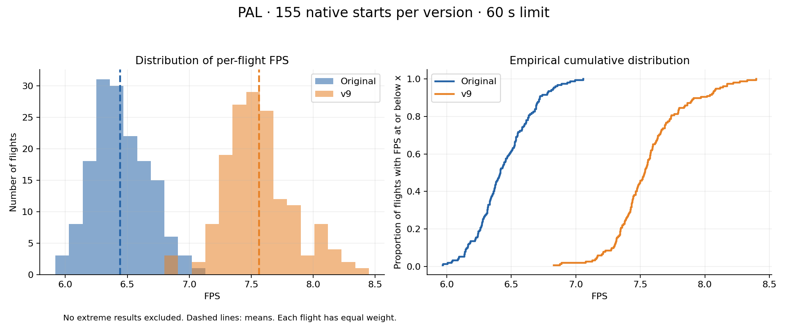
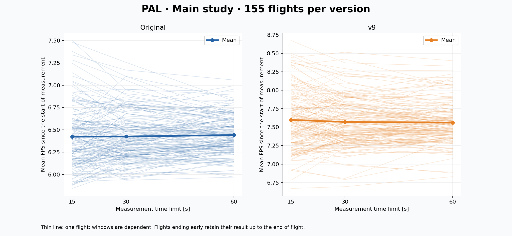
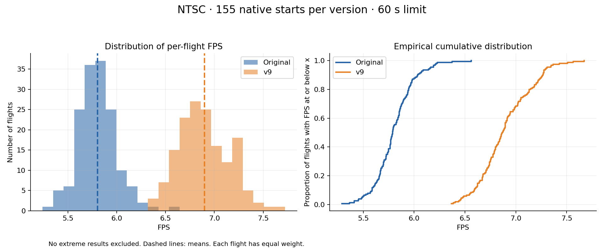
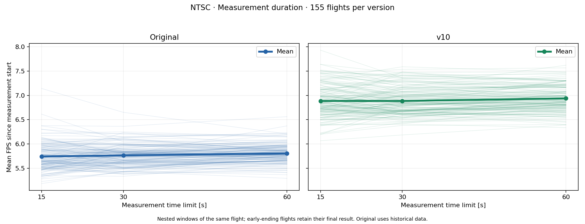

# Rescue on Fractalus! — optymalizacja dla Atari XL/XE

[English](README.md) · [Polski](README_PL.md)

Inżynieria wsteczna i optymalizacja w asemblerze 6502 gry **Rescue on Fractalus!** dla Atari XL/XE. Najnowszy build, **v10.1**, wykorzystuje **cartridge XEGS 128 KB** i działa na komputerach PAL i NTSC z 64 KB RAM, zachowując szczegółowość terenu i rozdzielczość obrazu.

## Pobieranie

W katalogu **[optimized version](optimized%20version/)** znajdują się najnowsze pliki `.car`, surowy `.rom` i krótka informacja o wersji. W emulatorze użyj `.car`; dla surowego ROM-u wybierz **XEGS 128 KB / typ cartridge'a 14**. Uruchom grę od zimnego startu.

## Zmierzona wydajność

Aktualne wydanie **v10.1** naprawia wznowienie gry klawiszem Esc. Poniższe wyniki i wykresy pochodzą z pomiarów **v10**; dla v10.1 nie wykonywano nowych testów FPS. Poprawka zmienia wyłącznie zdejmowanie kontekstu ze stosu przy wznowieniu.

| System | Oryginał | v10 | Przyrost do oryginału |
| --- | ---: | ---: | ---: |
| PAL | 6,4421 FPS | 7,6359 FPS | **+18,53%** |
| NTSC | 5,8043 FPS | 6,9377 FPS | **+19,53%** |

Są to średnie ze **155 lotów dla każdej wersji i systemu**, trwających do 60 sekund, uruchamianych w nowym procesie emulatora od zimnego startu. Dla v10 wykonano nową serię; oryginał wykorzystuje wcześniejszą serię odniesienia. Historyczne loty kontrolne odtworzono na tym samym emulatorze. Cztery odizolowane procesy emulatora zweryfikowano pod kątem pomiaru równoległego. Nie przenoszono zapisanych stanów ani nie odrzucano wyników odstających. [Raport v10](docs/benchmarks/RAPORT_V10_PL.md) zawiera przedziały ufności i historyczne porównanie z poprzednim wydaniem.

FPS oznacza liczbę ukończonych obrazów terenu, a nie częstotliwość odświeżania obrazu. Test obejmuje automatyczny lot z joystickiem w położeniu neutralnym; nie obejmuje skrętów ani nurkowania. Loty zakończone naturalnie przed upływem 60 sekund pozostają w próbie. Szczegóły zawierają [metoda pomiaru i raporty](docs/benchmarks/METODA_PL.md) (po polsku).

### PAL

### NTSC

## Co zoptymalizowano

- Naprawiono kontekst stosu przy wznowieniu po Esc, uwzględniając dodatkowy bajt ochrony banków.

- Zmieniono kolejność operacji rasteryzatora terenu i usunięto zbędną pracę po podziale odcinka.
- Przyspieszono dokładne dzielenie całkowitoliczbowe i usunięto zbędną normalizację.
- Wyspecjalizowano generowanie profilu gór dla typowych głębokości i szerokości.
- Ułożono tablice adresów wierszy plottera tak, by unikać przekraczania stron pamięci, i usunięto zbędne zapisy rejestru Y.
- Pominięto podziały terenu tylko tam, gdzie zachowawcza granica widoczności dowodzi ich całkowitego zasłonięcia.
- Wykorzystano dodatkowe banki ROM do bezpośredniego kasowania ekranu i wyspecjalizowanego wypełniania terenu.
- Zastąpiono powtarzane interpretowanie poleceń geometrii wyspecjalizowanym kodem i tablicami.
- Dodano szybkie ścieżki przycinania z oryginalnym algorytmem jako ścieżką zapasową.
- Przyspieszono interpolację za pomocą dokładnych tablic i samomodyfikującego się kodu w RAM.
- Rozwinięto pętle miksowania dźwięku i usunięto zbędne zerowanie flag dźwięku.
- Ograniczono aktualizację pasków PMG do zmienionych odcinków i skrócono pętle rysowania oraz kasowania PMG.
- Zabezpieczono przełączanie banków podczas przerwań i naprawiono synchronizację buforów obrazu, aby zapobiegać chwilowym artefaktom terenu.

Zobacz [pełny opis techniczny](docs/OPTYMALIZACJE_PL.md) i [instrukcję odtworzenia](docs/ODTWORZENIE_PL.md) (po polsku).

## Zawartość repozytorium

- **[optimized version/](optimized%20version/)** — najnowsze pliki CAR i ROM do uruchomienia oraz informacje o wersji i wydajności.
- **[original/](original/)** — niezmieniony oryginalny ROM, używany do budowania i jako punkt odniesienia pomiarów.
- **[dist/](dist/)** — pomocnicze pliki dystrybucji: aktualna łatka IPS i manifest buildu.
- **[src/](src/)** — źródła asemblera MADS dla optymalizacji i eksperymentów.
- **[scripts/](scripts/)** — narzędzia odtwarzania, analizy, weryfikacji, pomiarów i tworzenia wykresów.
- **[analysis/](analysis/)** — deasemblacja i analiza kodu wspierające inżynierię wsteczną.
- **[results/](results/)** — wybrane pomiary i wyniki weryfikacji w formacie maszynowym, w tym badania historyczne.
- **[docs/](docs/)** — zbiorczy opis zmian oraz badania pogrupowane tematycznie, m.in. PMG, teren i pomiary.

Starsze pliki wydań i ich opisy pozostają w historii Gita. Dokumenty badawcze są po polsku i mają nazwy z `_PL`. Repozytorium nie zawiera emulatorów, zapisanych stanów, zrzutów pamięci ani screenów z testów.
