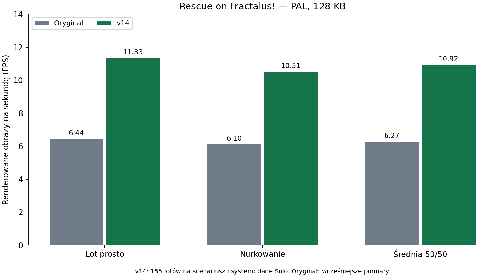
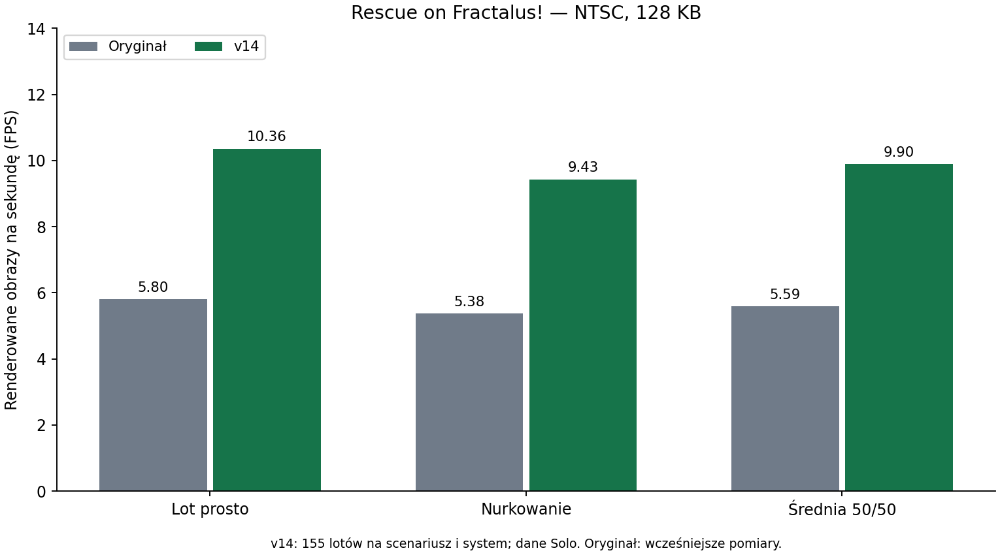

[English](README.md) · [Polski](README_PL.md)

# Rescue on Fractalus! — Atari XL/XE optimization

Nad projektem pracowali **nosty**, **Solo** i **ilmenit**, korzystając z agentów **ChatGPT 6 Astra/Sol** i **Claude Opus/Fable**. Ostatnie, największe optymalizacje są zasługą **Solo**.

## Pobierz grę

Zoptymalizowana gra **Rescue on Fractalus!** na Atari XL/XE zachowuje grafikę i zasady oryginału. **v14: cartridge 128 KB, wymagane 64 KB RAM.**

Pobierz **CAR** do emulatora lub **ROM**, jeśli sprzęt wymaga surowego obrazu. Uruchom grę od zimnego startu.

[**CAR**](optimized%20version/Rescue%20on%20Fractalus%21%20-%20optimized%20128KB.car) · [**ROM**](optimized%20version/Rescue%20on%20Fractalus%21%20-%20optimized%20128KB.rom)

## Wydajność

| System | Oryginał FPS | v14 FPS | Zysk względem oryginału |
|---|---:|---:|---:|
| PAL | 6,2717 | **10,9172** | **+74,07%** |
| NTSC | 5,5915 | **9,8961** | **+76,98%** |

## Jak mierzymy FPS

Każdy lot trwa do **60 sekund** i zaczyna się od świeżego uruchomienia gry. Badamy **PAL i NTSC**, w dwóch scenariuszach: lot prosto oraz nurkowanie (1 s joystick w górę, 3 s neutralnie). Wynik końcowy nadaje obu scenariuszom równą wagę **50/50**.

**Standardowa skrócona seria to 310 lotów łącznie:** 155 PAL i 155 NTSC; na każdy system przypada 78 lotów prosto i 77 z nurkowaniem.

**Wyniki v14 w tabeli pochodzą z większej serii wykonanej przez Solo: 620 lotów łącznie**, po 155 prosto i 155 z nurkowaniem dla każdego systemu. Weryfikacja obejmowała ponowne wykonanie 50 wybranych lotów z tej serii; nie była nową pełną serią 310 lotów. Wyniki oryginału pochodzą z zachowanych wcześniejszych pomiarów. Zysk obliczamy z ilorazu średnich FPS, a nie ze średniej procentowych zysków.

[Metodyka / Method](docs/benchmarks/METHOD_PL.md)

## Co zoptymalizowano — od początku projektu do v14

- Dokładna arytmetyka mnożenia, dzielenia i interpolacji została przyspieszona tablicami oraz specjalizowanym kodem, z zachowaniem zaokrągleń oryginału.
- Przyspieszono przygotowanie geometrii, przechodzenie po siatce terenu i klasyfikację punktów.
- Usprawniono rzutowanie perspektywiczne, obcinanie odcinków i pętlę krawędzi.
- Przepisano rasteryzację profilu gór, specjalizując częste przypadki i pomijając poddrzewa, których niewidoczność można dokładnie wykazać.
- Ograniczono kasowanie i wypełnianie obrazu dzięki granicom czystości kolumn, kasowaniu na żądanie i szybszej propagacji koloru.
- Przyspieszono plotter obiektów, obsługę grafiki PMG i wskaźników kokpitu.
- Zmniejszono koszt przerwań VBI, miksera dźwięku, kolejki efektów i wyboru kanałów.
- Wykorzystano czas oczekiwania na poprzedni obraz do bezpiecznych obliczeń, zachowując synchronizację buforów.
- Usunięto zbędne operacje rejestrów i pamięci, poprawiono układ gorących pętli oraz wykorzystano samomodyfikujący się kod w RAM.

[Szczegóły / Details](docs/OPTIMIZATIONS_PL.md) · [Budowanie / Rebuilding](docs/REBUILD_PL.md)

## Katalogi

- **optimized version/** — aktualne pliki gry do pobrania i informacja o wydaniu.
- **original/** — oryginalny obraz gry.
- **dist/** — łatka IPS i sumy kontrolne.
- **src/** — źródła asemblerowe i generatory.
- **scripts/** — budowanie gry, pomiary i tworzenie wykresów.
- **results/** — dane pomiarowe i wyniki weryfikacji.
- **docs/** — szczegółowy opis optymalizacji, metodyka i badania.
- **analysis/** — analiza oryginalnego kodu gry.
- **arc/** — historyczne materiały pomocnicze.
