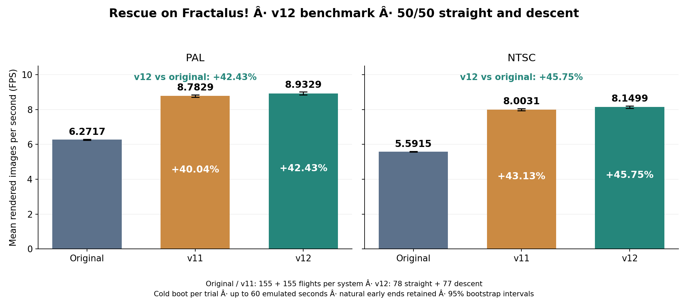

# v12 — lokalny build i pełny test FPS

Obecny kandydat compact został oznaczony jako v12 bez zmiany jego bajtów. Cartridge ma 128 KB; XEX wymaga 320 KB Rambo, 576 KB lub 1088 KB RAM i wyłączonego BASIC-a. Wydanie jest dostępne w gałęzi `v12`.

v12 kontynuuje prace nosty z ChatGPT-6 Astra oraz Solo z zespołem Opus/Fable. Obecny etap wykorzystuje także pomysły ilmenita, dostosowane i sprawdzone dla renderera v11.

| System | Oryginał FPS | v11 FPS, pełna referencja | v12 FPS | Zysk v12 względem oryginału |
|---|---:|---:|---:|---:|
| PAL | 6.2717 | 8.7829 | **8.9329** | **+42.43%** |
| NTSC | 5.5915 | 8.0031 | **8.1499** | **+45.75%** |

Wynik jest średnią 50/50 średnich obu scenariuszy. Oryginał i v11: po 155 lotów prosto i 155 z nurkowaniem na system; v12: 78 prosto i 77 z nurkowaniem na system. Każdy lot startuje od początku. Pomiary dotyczą CAR na Atari 800XL/64 KB.



## Zmiany względem v11

- Dokładny skrót `$AA` przyspiesza fill, gdy wszystkie 42 bajty wiersza sterującego mają tę wartość; zachowuje cache i stan wyjściowy.
- Wcześniejszy test pierwszej kolumny skraca nieudane sprawdzanie zasłonięcia, a mała tablica zastępuje obliczanie liczby grup czterech kolumn.
- Skan wejściowy trzyma próg wysokości w A i zachowuje osobny przypadek `Hmax=0`.
- Usunięto dalszą zbędną obsługę Y w głębokościach d0–d4, przywracając Y=5 przed kodem ogólnym.
- Skrócono klasyfikację punktów geometrii 33–44 i ustawianie pożyczki; kolejność próbkowania mapy jest zachowana.

Kod odrzuconego pustego widoku, większe drzewa odcinków i eksperyment odległych gór nie są częścią v12.

## Pliki i odtworzenie

- [Rescue on Fractalus! - optimized v12 128KB.car](../../optimized%20version/Rescue%20on%20Fractalus!%20-%20optimized%20128KB.car): 131088 bajtów.
- [Rescue on Fractalus! - optimized v12 128KB.rom](../../optimized%20version/Rescue%20on%20Fractalus!%20-%20optimized%20128KB.rom): 131072 bajtów.
- [Rescue on Fractalus! - optimized v12 320KB-1MB.xex](../../optimized%20version/Rescue%20on%20Fractalus!%20-%20optimized%20320KB-1MB.xex): 262699 bajtów.

`manifest.json` identyfikuje bajty i źródła. `sources/` zawiera niezmienione kopie sześciu źródeł MADS i obu builderów. Ich pierwotny układ ścieżek projektu jest zachowany w treści; polecenia budowania uruchamiamy z głównego folderu projektu:

```text
python scripts/rebuild_current.py --mads PATH_TO_MADS
python scripts/benchmark_v12.py
python scripts/report_v12.py
python scripts/plot_v12.py

```

Ponowne uruchomienie benchmarku wznawia istniejący, zgodny zamrożony plan; nie jest nowym niezależnym badaniem. Surowe obserwacje, plan, raport i wykres są w `results/v12/`.

Build zachowuje wcześniejszą poprawkę Esc oraz loader XEX z poprawionymi tablicami muzyki końca poziomu. Wcześniejsze testy identycznego kandydata obejmują renderer, pauzę i kontrolowane przejścia poziomów XEX; zakres i hasze dowodów są w `results/v12/functional-validation.json`.

## Dokładność i porównania

### PAL

v12: **8.932929 FPS**, przedział bootstrap 95% [8.854022, 9.011272].

| Referencja | FPS referencji | Różnica FPS | Zysk | Przedział 95% zysku |
|---|---:|---:|---:|---:|
| Oryginał, pełne dane | 6.271731 | +2.661198 | +42.4316% | [+41.0787%, +43.7830%] |
| v11, pełne dane | 8.782928 | +0.150001 | +1.7079% | [+1.0790%, +2.3444%] |
| v11, te same 155 prób | 8.743560 | +0.189369 | +2.1658% | [+1.6135%, +2.6986%] |

Naturalne wcześniejsze końce: 8/155. Zakres mierzonego czasu: 36.823–60.188 s. Średni czas rzeczywisty jednej próby, ze startem i menu: 15.81 s; samo wywołanie pomiaru: 11.16 s.
### NTSC

v12: **8.149851 FPS**, przedział bootstrap 95% [8.080669, 8.218045].

| Referencja | FPS referencji | Różnica FPS | Zysk | Przedział 95% zysku |
|---|---:|---:|---:|---:|
| Oryginał, pełne dane | 5.591516 | +2.558335 | +45.7539% | [+44.4038%, +47.0836%] |
| v11, pełne dane | 8.003108 | +0.146743 | +1.8336% | [+1.1732%, +2.4948%] |
| v11, te same 155 prób | 7.991736 | +0.158115 | +1.9785% | [+1.4598%, +2.4902%] |

Naturalne wcześniejsze końce: 9/155. Zakres mierzonego czasu: 36.664–60.161 s. Średni czas rzeczywisty jednej próby, ze startem i menu: 15.51 s; samo wywołanie pomiaru: 10.98 s.

## Metoda i kontrola danych

Nowa seria obejmuje 310 niezależnych zimnych startów: 155 PAL i 155 NTSC, na czterech izolowanych emulatorach. Zajęła 20.25 min czasu rzeczywistego. To świeże pomiary v12; wyniki oryginału i v11 są zachowanymi danymi historycznymi.

Przydział 78/77 i kolejność startów ustalono wcześniej. Każdy start ma 170 ramek rozgrzewki. FPS liczy całe odstępy między prezentacjami `$B516` według zegara Atari. Okno nominalne ma 60 s, domknięte do całego odstępu; naturalny koniec kończy je wcześniej. Nurkowanie: joystick w górę na 1 s, neutralnie przez 3 s, powtarzane co 4 s. Terminy joysticka zgadzają się co do cyklu z ustalonym harmonogramem. Nie przenoszono stanów między ROM-ami, nie odrzucano wyników ani nie ponawiano poprawnych prób w celu poprawienia średniej.

Sterownik paczkowy zachowuje pełną listę prezentacji, terminy sterowania i migawkę RAM właściwą dla końca próby. Użyto tego samego pliku emulatora co w audycie; niezbudowana propozycja zmiany jego pętli oczekiwania nie została zastosowana. `integrity.json` potwierdza liczebność, monotoniczność znaczników, arytmetykę FPS oraz terminy wejścia.

Przedziały ufności: 20 000 replik percentylowego bootstrapu, ziarno 2026102912. Losujemy całe plany startu osobno w grupach 78 i 77, zachowując współzależność v11 i historycznego nurkowania oryginału. Loty prosto oryginału pochodzą z niezależnego planu i są losowane niezależnie. Zysk jest ilorazem średnich, nie średnią procentów. Etykiety scenariuszy są zachowane wewnętrznie, chociaż główny wynik jest łączny.

Pełne referencje i v12 mają różną liczebność. Porównanie z v11 dla tych samych 155 przydzielonych prób ogranicza wpływ zmiany składu próby i jest dodatkową oceną przyrostu od v11. Nie zastępuje głównej referencji oryginału. Test opisuje dwa ustalone scenariusze automatyczne, nie wszystkie możliwe sytuacje w grze.

## Pliki danych

- `plan.json`, `analysis-plan.json`: zamrożony plan pomiarów i obliczeń.
- `flights.jsonl`, `flights.csv`: 310 indywidualnych wyników; JSONL zawiera wszystkie znaczniki obrazów i joysticka.
- `summary.json`, `integrity.json`, `run.json`: statystyki, kontrola poprawności i czas wykonania.
- `functional-validation.json`: hasze wcześniejszych testów identycznych binariów i dokładne oznaczenie ich zakresu.
- `charts/V12_COMPARISON.png` / `.svg`: wykres z angielskimi opisami.

ROM SHA-256: `4959a82ab36528a0448a40e6178fdb72d321e5d1e23c258036f5e22e51cfa20e`.
Plan SHA-256: `7ebe095a3bc081af064114256a0590d2ed78afb91ac8644bd15d987b55ac4e8b`.
